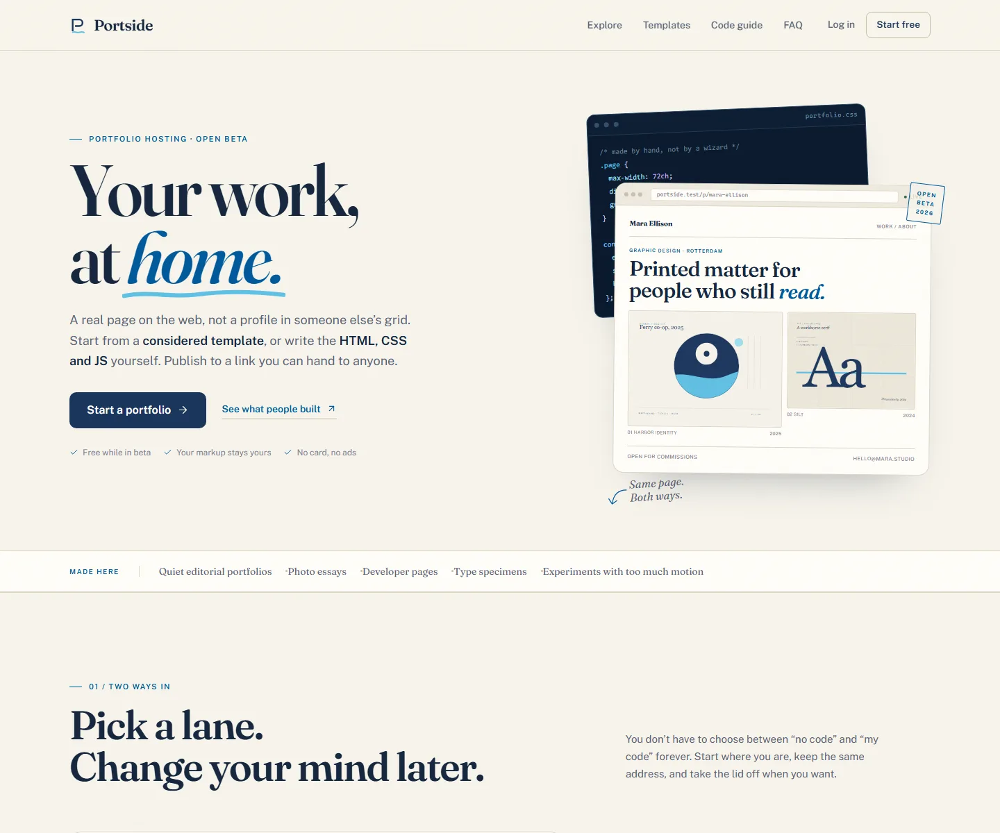
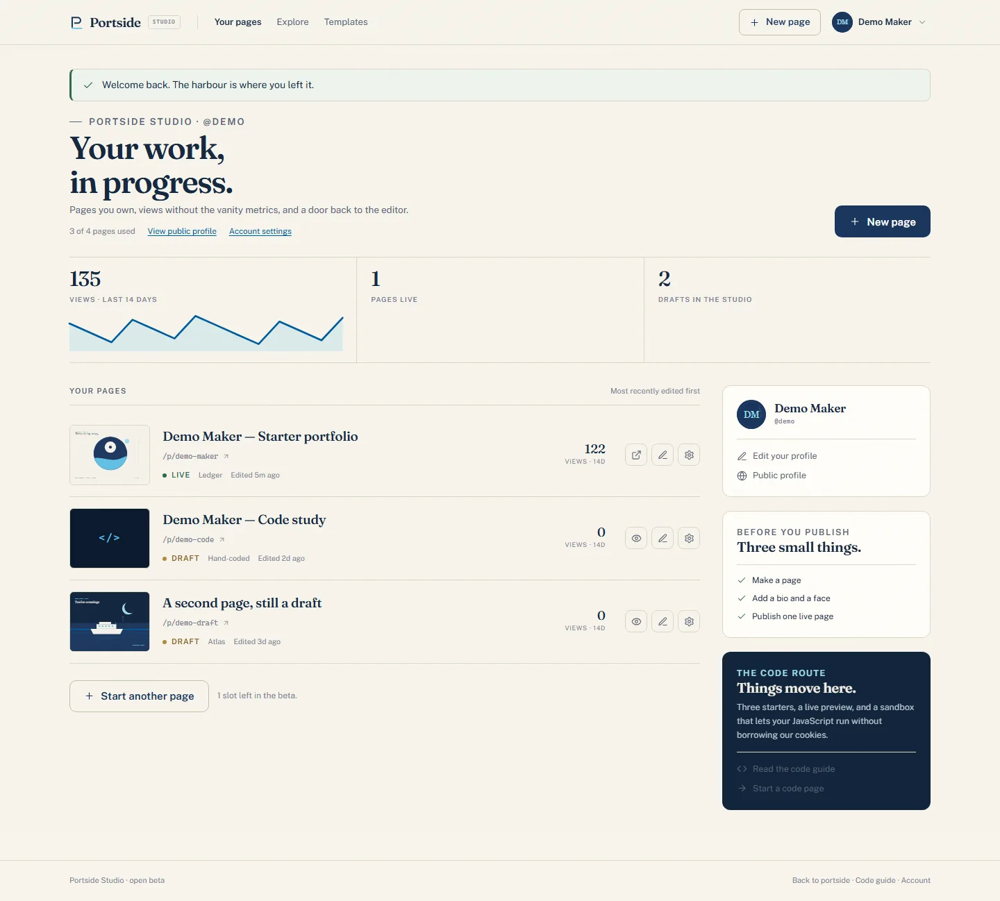
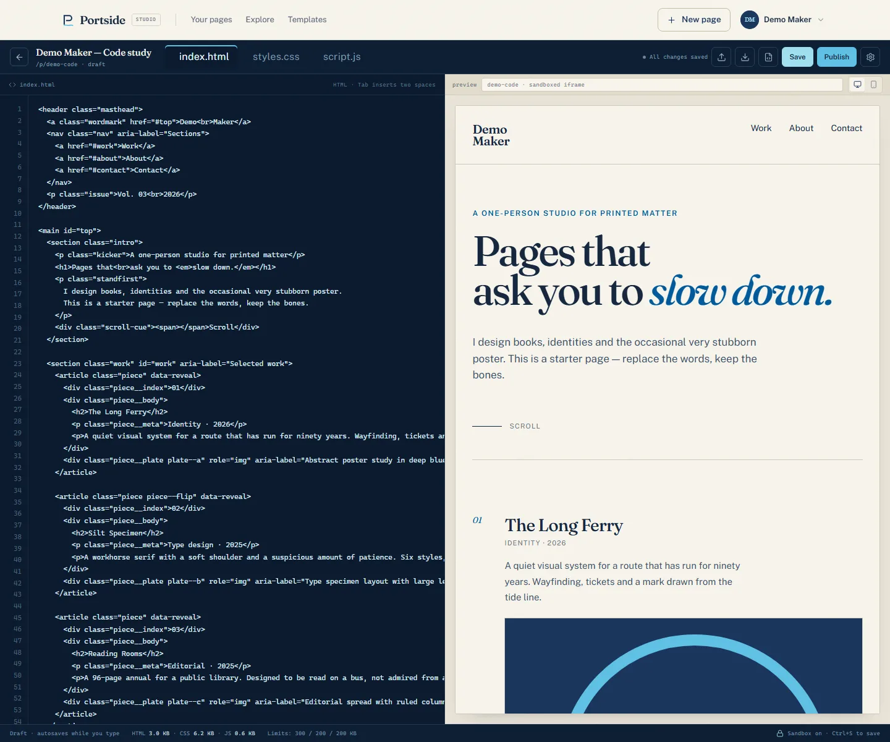
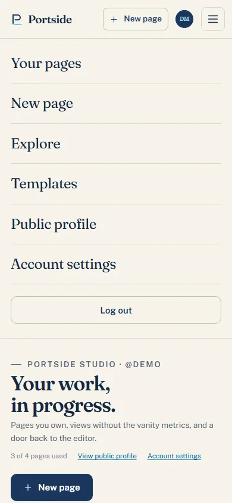
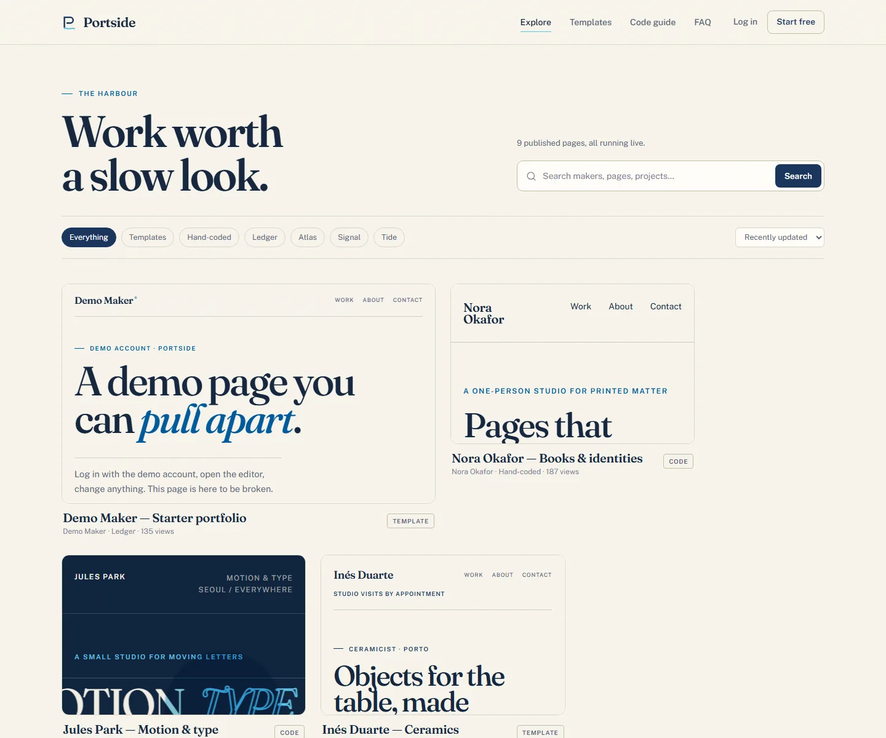
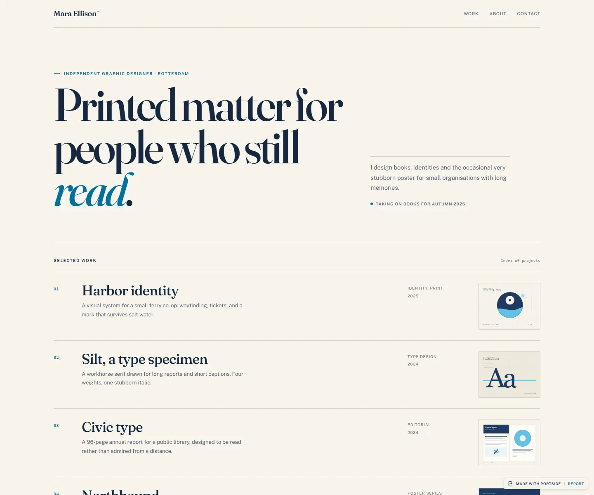

# Portside

A multi-user portfolio host built with Laravel. People can publish a considered **template** portfolio without touching code, or open a sandboxed **HTML / CSS / JS editor** and build the page themselves. Every page gets a public address, a place in Explore, view counts without third-party tracking, and an export button when it is time to leave.

The interface follows the supplied design system and its three-colour palette: deep navy `#1B365D`, harbour blue `#005A9C`, and signal cyan `#60C1E5` on warm paper. Fraunces and Public Sans are self-hosted; Lucide-style inline icons keep the interface free of emoji.

## A look at it









The public side, including the live template previews:






## What is included

- Two ways to make a page: four shared-content templates (Ledger, Atlas, Signal, Tide) or a hand-coded page.
- A real code studio: HTML, CSS and JS panes, autosave, a live iframe preview, desktop/phone widths, image upload and one-file export.
- Three editable code starters: blank canvas, editorial and kinetic type.
- Public portfolio pages, a searchable/filterable Explore, maker profiles, SEO metadata and sitemap.
- Accounts, profiles, avatars, password changes, four-page beta limit, daily view counts and a small report/moderation desk.
- Security: CSRF-protected forms, rate-limited auth and reports, escaped template content, allow-listed links, raster-only re-encoded uploads, and opaque-origin sandboxing for user JavaScript.
- A seeded demo: nine makers, nine live pages and two drafts, so the site is not empty on first boot.

## Requirements

- PHP 8.3+ with `pdo_sqlite`, `gd`, `mbstring` and `fileinfo`
- Composer 2
- No Node/npm build step. The platform CSS and JS are served from `public/assets`.

## Run it

This folder already has dependencies, an application key, a SQLite database and demo content. Start the server:

```bash
php artisan serve
```

Open <http://127.0.0.1:8000>.

To rebuild everything from a clean checkout:

```bash
composer install
cp .env.example .env
php artisan key:generate
php artisan migrate --seed
php artisan serve
```

On Windows, `copy .env.example .env` works in place of `cp`. `composer setup` performs those steps too.

### Demo accounts

| Role | Login | Password |
| --- | --- | --- |
| Maker studio | `demo@portside.test` | `portside-demo` |
| Moderation desk | `admin@portside.test` | `portside-admin` |

The demo maker owns a published template page, a private code page and a draft template. Every other seeded maker has a password that is not published. Use the demo account to inspect both editors.

### Laragon

Point the site’s document root at `public/` for the cleanest setup. The included root `.htaccess` forwards Apache requests into `public/` if your virtual host points at the project root instead. Update `APP_URL`, then run `php artisan migrate --seed`.

### MySQL instead of SQLite

Uncomment the MySQL entries in `.env.example`, set the database credentials in `.env`, create the database, and run:

```bash
php artisan migrate:fresh --seed
```

Uploaded images stay in `public/uploads`, so no storage symlink is needed.

## How it works

```
app/
  Http/Controllers/        public site, auth, studio, moderation
  Models/                  User, Portfolio, PortfolioView, Report
  Services/                TemplateRegistry, CodeStarter, PortfolioRenderer, ImageUploader
  View/Components/         icons, brand mark
resources/
  views/                   platform, studio, auth, admin and portfolio templates
  starters/                three editable custom-code starter projects
public/
  assets/                  self-hosted fonts, platform CSS, portfolio CSS, editor JS
  uploads/                 re-encoded user images
tests/Feature/             auth, portfolio, code sandbox, uploads, reports, rendering
```

- Template content is stored as a normalised JSON document. Switching templates preserves the content.
- Code pages store three source strings. HTML fragments are wrapped in a minimal document; full documents receive the CSS before `</head>` and the JS before `</body>`.
- The code page response carries `Content-Security-Policy: sandbox allow-scripts ...` **without** `allow-same-origin`. The page runs in an opaque origin and cannot read platform cookies, storage or same-origin endpoints. The live preview uses a sandboxed `srcdoc` iframe as well.
- The sandboxed font stylesheet is served through `/fonts/{file}` with CORS so custom pages can still use the self-hosted typefaces. Other assets stay normal static files.
- Image uploads are verified, decoded through GD, re-encoded to JPG/PNG/WebP and stored under `public/uploads/{user_id}`. SVG uploads are refused.

## Beta limits

- Four pages per account
- 5 MB per image; 300 KB HTML; 200 KB CSS; 200 KB JS
- No custom domains or server-side code yet
- Email is used for account essentials only; there is no email verification flow in this beta

## Tests

```bash
php artisan test
```

The suite covers registration/login, page ownership, template content, autosave payloads, publishing, the custom-code sandbox headers and export, uploads, reports, moderation, view counting, sitemap and escaping.

## Design notes

- Warm paper background, one navy action colour, one blue supporting tone, cyan used sparingly.
- Fraunces for display type and Public Sans for text, with real italics and local font files.
- Asymmetric hero, two-column route cards, editorial template shots and a numbered feature ledger instead of a grid of equal cards.
- Persistent 1px borders, modest radii and no decorative gradients. Motion is limited to state transitions and hover feedback; user code can animate freely inside its own page.
